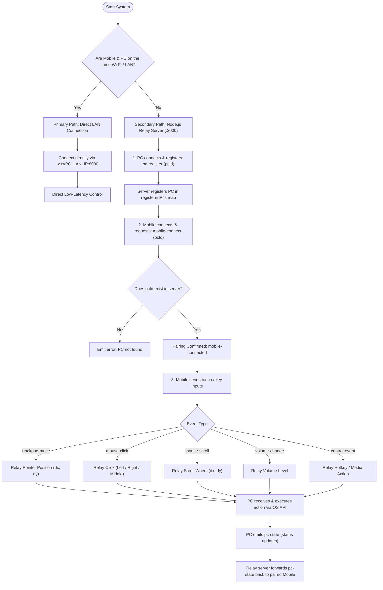
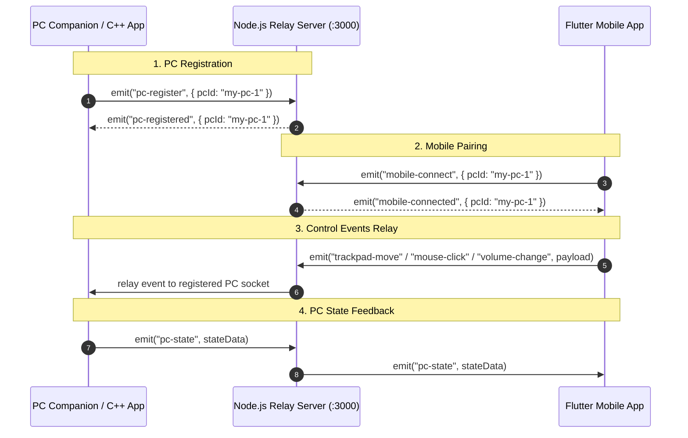
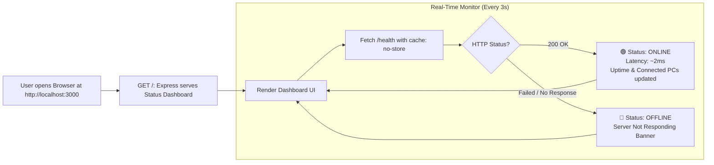

# Remote Control Backend & Relay Server

A lightweight Node.js & Socket.IO server designed to monitor system health and relay trackpad, mouse, volume, and control events between Flutter mobile devices and PC applications.

---

## 📊 Complete Flow Diagrams

### 1. End-to-End System & Architecture Flow



---

### 2. Device Registration & Relay Sequence



---

### 3. Server Status & Health Check UI Flow



---

## 📋 System Stages Summary

| Stage | Action | Protocol / Port |
| :--- | :--- | :--- |
| **Status Check** | Open browser to check if server is active | HTTP `GET /` on port `3000` |
| **PC Registration** | PC tells server it is ready for remote commands | Socket.IO `pc-register` |
| **Mobile Pairing** | Mobile app links to a specific PC ID | Socket.IO `mobile-connect` |
| **Control Events** | Mouse movements, clicks, and volume commands | Socket.IO events forwarded from Mobile $\to$ Server $\to$ PC |

---

## 🚀 How to Run

1. **Install dependencies:**
   ```bash
   npm install
   ```

2. **Start the server:**
   ```bash
   npm start
   ```
   *Or for auto-reload during development:*
   ```bash
   npm run dev
   ```

---

## 🌐 Endpoints & UI

| URL | Type | Description |
| :--- | :--- | :--- |
| **`http://localhost:3000/`** | Web Dashboard | Visual real-time dashboard showing server status (Online 🟢 / Offline 🔴), port, uptime, and connected devices with laptop/mobile icons. |
| **`http://localhost:3000/health`** | REST API | Returns JSON payload with `{ status, uptimeSeconds, registeredPcs, connectedMobiles, totalDevices, port, devices }`. |
| **`http://localhost:3000/api/devices`** | REST API | Returns connected devices with names, types (`laptop` / `mobile`), IPs, and paired hosts. |
| **`ws://localhost:3000/socket.io/`** | WebSocket | Socket.IO endpoint used for PC registration and mobile remote control relay. |

---

## 📡 Socket.IO Event Reference

### Mobile -> Server
- `mobile-connect`: `{ pcId, deviceName?, deviceType? }` - Pair mobile client with a registered PC (e.g. `{ pcId: "pc-1", deviceName: "Pixel 8", deviceType: "mobile" }`)
- `trackpad-move`: `{ dx, dy }` - Relative trackpad pointer movement
- `mouse-click`: `{ button: "left" | "right" | "middle" }` - Mouse click event
- `mouse-scroll`: `{ dx, dy }` - Scroll wheel motion
- `volume-change`: `{ level }` - System volume control
- `control-event`: `{ key, action }` - Custom media / hotkey trigger

### PC -> Server
- `pc-register`: `{ pcId, pcName?, deviceType? }` - Register PC as available for remote pairing (e.g. `{ pcId: "pc-1", pcName: "Gaming Laptop", deviceType: "laptop" }`)
- `pc-state`: `{ ... }` - Broadcast PC status updates to paired mobile clients
